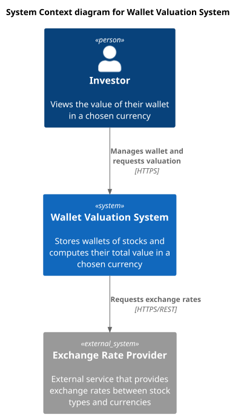

# 3. System Scope and Context

This chapter describes the system boundary of the **Wallet Valuation System** and its communication partners. It defines what is inside the system, what is outside, and which interfaces connect them.

The scope is derived from the Wallet kata requirements, the existing C4 system context diagram, and ADR-001.

## 3.1 Business Context

The business context shows who uses the Wallet Valuation System and which external system it depends on to perform wallet valuation.

### System Context Diagram

The authoritative C4 system context diagram is maintained in [`diagrams/c4-context.puml`](diagrams/c4-context.puml). The generated SVG is included below for convenience.

### Communication Partners

| Partner | Type | Inputs to Wallet Valuation System | Outputs from Wallet Valuation System | Purpose / Business Meaning |
|---|---|---|---|---|
| **Investor** | Person | Wallet management requests (create/update/read wallet stocks: quantity and stock type); valuation requests specifying a target currency. | Current wallet contents; computed total wallet value in the chosen currency; validation or error responses. | The investor uses the system to understand the value of their holdings in a currency they choose. |
| **Exchange Rate Provider** | External system | Exchange-rate responses for requested stock/currency pairs (or equivalent conversion information), including success/failure signals. | Exchange-rate lookup requests for the stock types/currencies needed to compute a valuation. | The system depends on external market/conversion data to convert heterogeneous stock types into one target currency. The concrete provider is not fixed; it is accessed through a rate provider interface/adapter (ADR-001, TC-5). |

### Business Scope

| In scope | Out of scope |
|---|---|
| Storing wallet stocks as quantity + stock type. | User registration, authentication/authorization design beyond what is needed for the API boundary (to be decided later if required). |
| Computing total wallet value in a user-chosen currency. | Portfolio analytics, trading, order execution, or historical performance tracking. |
| Obtaining exchange/conversion rates from an external provider through an interface. | Selecting/contracting a specific exchange-rate vendor; the concrete provider is replaceable behind an adapter. |
| Exposing an HTTP API for wallet and valuation operations. | Graphical user interface, mobile app, or batch reporting UI. |

## 3.2 Technical Context

The technical context maps the business interactions to concrete communication channels, protocols, and data-exchange responsibilities. It refines the boundaries shown in the C4 context diagram without changing them.

### Technical Context Overview

| Business interaction | Technical channel | Protocol / Format | Initiator | Notes |
|---|---|---|---|---|
| Investor manages wallet and requests valuation | Investor client to API Gateway / Wallet API | **HTTPS**; request/response payload format expected to be JSON over HTTP (API detail to be specified in later chapters) | Investor | Matches C4 relation: `Investor -> Wallet Valuation System: "Manages wallet and requests valuation" (HTTPS)`. The API is exposed through Amazon API Gateway HTTP API in front of AWS Lambda (ADR-001). |
| Wallet system requests exchange rates | Wallet Valuation System to External Exchange Rate Provider | **HTTPS/REST**; provider-specific request/response format handled by an adapter | Wallet Valuation System | Matches C4 relation: `Wallet Valuation System -> Exchange Rate Provider: "Requests exchange rates" (HTTPS/REST)`. The valuation domain uses a rate provider interface; the adapter translates domain rate requests into provider calls and normalizes responses. |

### Interface Details

#### I-1: Investor ↔ Wallet Valuation System

| Aspect | Description |
|---|---|
| **Partner** | Investor (human user or API client acting on their behalf). |
| **Direction** | Bidirectional request/response over HTTPS. |
| **Business purpose** | Manage wallet stocks and request total valuation in a chosen currency. |
| **Technical realization** | API Gateway HTTP API endpoint invoking AWS Lambda handlers (ADR-001, TC-2). |
| **Data exchanged** | Input: stock entries (`stock type`, `quantity`), wallet identifier/selection as applicable, target currency for valuation. Output: stored wallet representation, valuation result (total amount + currency), and error details. |
| **Availability expectations** | Available on demand; serverless compute may introduce cold-start latency after idle periods (ADR-001 consequence). |
| **Security / trust** | HTTPS in transit. Authentication/authorization is not defined by the kata and is a future decision if the system moves beyond course scope. |

#### I-2: Wallet Valuation System ↔ Exchange Rate Provider

| Aspect | Description |
|---|---|
| **Partner** | Exchange Rate Provider (external, third-party system). |
| **Direction** | Outbound request from Wallet Valuation System; inbound response from provider. |
| **Business purpose** | Obtain conversion rates needed to value stock types in the target currency. |
| **Technical realization** | HTTPS/REST call performed by a provider adapter implementing the internal rate provider interface (ADR-001, TC-5). |
| **Data exchanged** | Input: source stock type/currency, target currency, and optionally quantity/context required by provider API. Output: exchange rate or convertible value, timestamp/freshness metadata if available, or provider error. |
| **Availability expectations** | External dependency; availability, latency, rate limits, and terms are outside system control. Failures must be handled explicitly (ADR-001 consequence). |
| **Security / trust** | HTTPS in transit. Provider credentials/API keys, if required by a chosen provider, are deployment configuration and must not be embedded in domain logic. |

### Mapping to Architecture Constraints

| Constraint | Impact on Context |
|---|---|
| **TC-5 / ADR-001** | The Exchange Rate Provider is an external system at the context boundary, but its concrete implementation is hidden behind an internal interface/adapter. |
| **TC-6** | Communication protocols at the boundary follow the C4 context diagram: HTTPS for investor interaction, HTTPS/REST for rate provider integration. |
| **TC-2 / TC-3** | Internal technical realization uses API Gateway + Lambda + DynamoDB, but these are internal building blocks; the external context remains the Investor and Exchange Rate Provider. |
