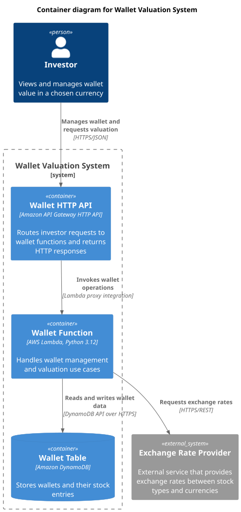
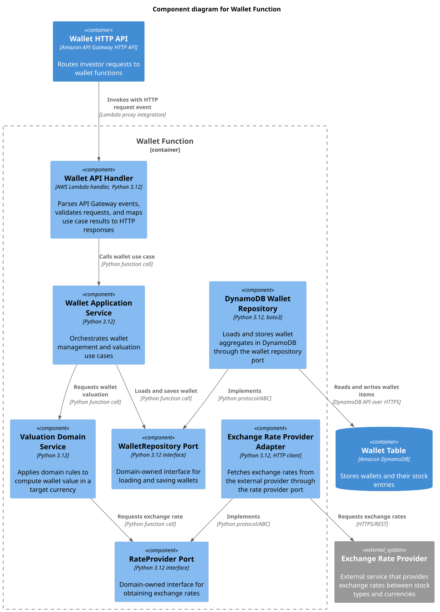

# 5. Building Block View

This chapter describes the static decomposition of the **Wallet Valuation System** into building blocks. It starts with the system-level container view and then refines the main application container.

## 5.1 Level 1: System Container View

### Overview

The Wallet Valuation System is decomposed into a small serverless container set. API Gateway exposes the HTTP boundary, a Python Lambda function contains the wallet application and domain logic, DynamoDB stores wallet data, and the external Exchange Rate Provider supplies conversion rates. This decomposition aligns with ADR-001 and the C4 system context in Chapter 3.

### C4 Container Diagram

Source: [`diagrams/c4-container.puml`](diagrams/c4-container.puml)

### Container Responsibilities

| Container | Technology | Responsibility |
|---|---|---|
| **Wallet HTTP API** | Amazon API Gateway HTTP API | Public HTTP entry point. Routes investor requests to the Wallet Function and returns HTTP responses. |
| **Wallet Function** | AWS Lambda, Python 3.12 | Implements wallet management and valuation use cases. Contains API handling, application orchestration, domain valuation rules, and adapters for persistence and external rates. |
| **Wallet Table** | Amazon DynamoDB | Persists wallet data and stock entries. Designed for wallet read/write access patterns with on-demand billing. |
| **Exchange Rate Provider** | External system | Provides exchange rates/conversion information needed to value stocks in a target currency. Accessed only through an adapter behind a domain port. |

### Key Interfaces

| From | To | Interface / Protocol | Purpose |
|---|---|---|---|
| Investor | Wallet HTTP API | HTTPS/JSON | Manage wallets and request wallet valuation in a chosen currency. |
| Wallet HTTP API | Wallet Function | Lambda proxy integration | Forward HTTP requests to application code and return function responses. |
| Wallet Function | Wallet Table | DynamoDB API over HTTPS | Read and persist wallet aggregates/stock entries. |
| Wallet Function | Exchange Rate Provider | HTTPS/REST | Obtain exchange rates required for valuation. The concrete provider is replaceable through the rate provider adapter. |

## 5.2 Level 2: Wallet Function

### Overview

The Wallet Function is the main executable container. It is internally structured using a ports-and-adapters style so the domain valuation logic remains independent of AWS and external provider details.

### C4 Component Diagram

Source: [`diagrams/c4-component-wallet-function.puml`](diagrams/c4-component-wallet-function.puml)

### Component Responsibilities

| Component | Technology | Responsibility |
|---|---|---|
| **Wallet API Handler** | AWS Lambda handler, Python 3.12 | Entry adapter. Parses API Gateway proxy events, validates basic request shape, invokes application use cases, and maps results/errors to HTTP responses. |
| **Wallet Application Service** | Python 3.12 | Application layer. Orchestrates use cases such as get wallet, update wallet, and calculate wallet value. Coordinates domain services and ports without embedding infrastructure details. |
| **Valuation Domain Service** | Python 3.12 | Domain logic. Computes total wallet value in the requested currency by applying valuation rules over wallet stocks and exchange rates obtained through the rate provider port. |
| **DynamoDB Wallet Repository** | Python 3.12, boto3 | Driven adapter. Implements the wallet repository port by reading and writing wallet items in DynamoDB. |
| **Exchange Rate Provider Adapter** | Python 3.12, HTTP client | Driven adapter. Implements the rate provider port by calling the external Exchange Rate Provider over HTTPS/REST and translating responses into domain-friendly rate data. |

### Internal Ports and Boundaries

| Port / Boundary | Type | Purpose | Implemented / Used by |
|---|---|---|---|
| **WalletRepository** | Driven port (interface) | Abstracts wallet persistence from the application/domain. Enables in-memory/fake repositories in tests. | Used by Wallet Application Service; implemented by DynamoDB Wallet Repository. |
| **RateProvider** | Driven port (interface) | Abstracts exchange-rate lookup from valuation logic. Enables fake providers in tests and replacement of external vendors. | Used by Valuation Domain Service; implemented by Exchange Rate Provider Adapter. |
| **HTTP API boundary** | Driving adapter boundary | Translates external HTTP requests into application commands/queries and maps outcomes back to HTTP. | Implemented by Wallet API Handler. |

### Important Design Decisions at This Level

- **Single deployable function initially:** The kata scope is small, so wallet management and valuation are kept in one Lambda container/function to reduce operational complexity. This can be split later if responsibilities or scaling characteristics diverge.
- **Domain isolation:** Valuation rules do not depend on boto3, API Gateway event formats, or provider-specific HTTP payloads.
- **Adapter replaceability:** The Exchange Rate Provider is an external system in the context/container views, but inside the Wallet Function it is accessed only through `RateProvider` and its adapter, consistent with ADR-001 and TC-5.
- **DynamoDB access encapsulation:** Only the DynamoDB Wallet Repository knows table keys, item shapes, and DynamoDB API calls. This limits the impact of DynamoDB-specific access-pattern constraints (TC-3).
