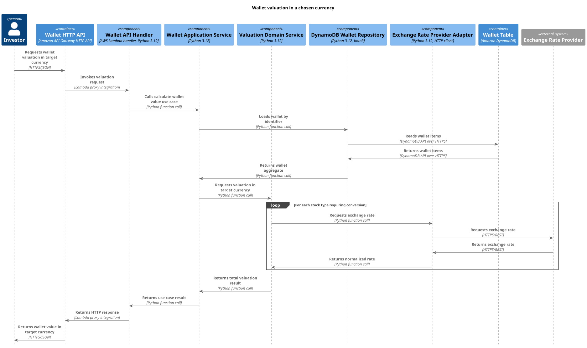
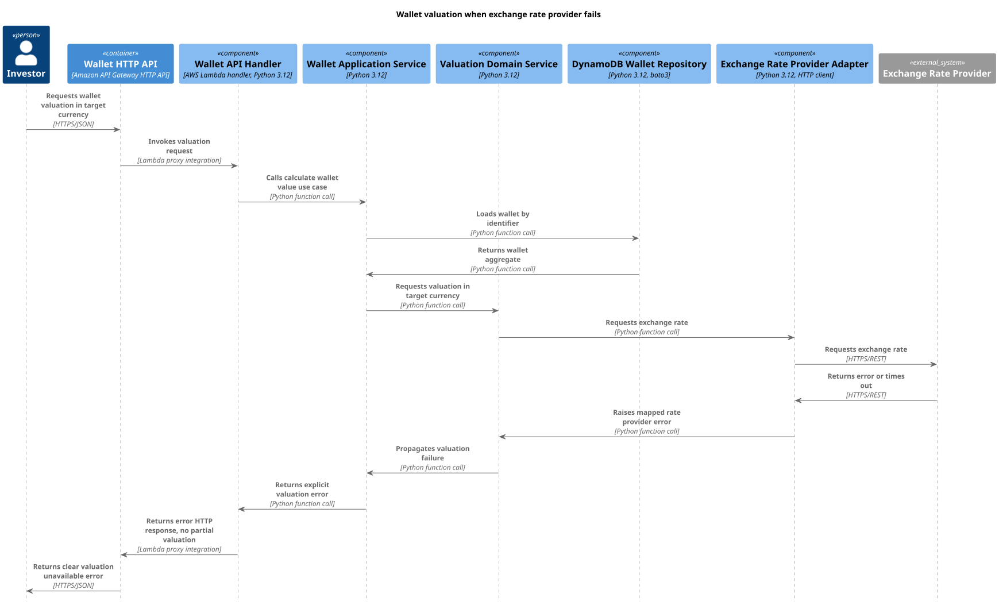

# 6. Runtime View

This chapter describes important runtime scenarios of the **Wallet Valuation System**. It focuses on how building blocks from Chapter 5 collaborate at runtime, including the key success path and a critical failure path.

The diagrams show concrete runtime participants (handlers, services, adapters, infrastructure). The design intent behind this structure is described in Chapters 4 and 5: domain logic depends on ports, and adapters implement those ports at the infrastructure boundary.

## 6.1 Scenario: Calculate Wallet Value in a Chosen Currency

### Purpose

An investor requests the total value of a wallet in a selected target currency. The system loads the wallet, obtains required exchange rates through the exchange-rate adapter, computes the total using domain rules, and returns the result.

### Sequence Diagram

Source: [`diagrams/sequence-wallet-valuation.puml`](diagrams/sequence-wallet-valuation.puml)

### Runtime Steps

| Step | Participants | Description |
|---|---|---|
| 1 | Investor -> Wallet HTTP API | The investor sends an HTTPS/JSON request to value a wallet in a target currency. |
| 2 | Wallet HTTP API -> Wallet API Handler | API Gateway invokes the Wallet Function using Lambda proxy integration. |
| 3 | Wallet API Handler -> Wallet Application Service | The handler validates/parses the request and calls the valuation use case. |
| 4 | Wallet Application Service -> DynamoDB Wallet Repository | The application requests the wallet aggregate by identifier through the repository implementation. |
| 5 | DynamoDB Wallet Repository -> Wallet Table | The repository reads wallet items from DynamoDB and reconstructs the wallet aggregate. |
| 6 | Wallet Application Service -> Valuation Domain Service | The application passes the wallet and target currency to the domain valuation service. |
| 7 | Valuation Domain Service -> Exchange Rate Provider Adapter | For each stock type requiring conversion, the domain requests an exchange rate through the adapter implementation. |
| 8 | Exchange Rate Provider Adapter -> Exchange Rate Provider | The adapter translates the domain request into the provider-specific HTTPS/REST call and normalizes the response. |
| 9 | Valuation Domain Service | The domain computes the total wallet value in the target currency using the returned rates. It does not produce partial results. |
| 10 | Wallet API Handler -> Investor | The handler maps the use case result to an HTTP response containing the total valuation and currency. |

### Notable Behavior

- **Domain isolation:** Valuation rules remain domain-focused; ports define the dependency boundary, while adapters supply DynamoDB and external provider integrations at runtime.
- **Adapter responsibility:** The Exchange Rate Provider Adapter handles provider protocol details and response normalization.
- **Correctness:** Valuation is computed only after required rates are available; missing rates cause an explicit failure rather than an estimated or partial total.

## 6.2 Scenario: Exchange Rate Provider Failure

### Purpose

During valuation, the external Exchange Rate Provider may be unavailable, return an error, or time out. The system must fail explicitly and must not return a partial or incorrect valuation.

### Sequence Diagram

Source: [`diagrams/sequence-rate-provider-failure.puml`](diagrams/sequence-rate-provider-failure.puml)

### Runtime Steps

| Step | Participants | Description |
|---|---|---|
| 1 | Investor -> Wallet HTTP API -> Wallet API Handler | The investor requests a valuation; the request reaches the Wallet Function as in the success scenario. |
| 2 | Wallet Application Service -> DynamoDB Wallet Repository | The application loads the wallet aggregate through the repository implementation. |
| 3 | Valuation Domain Service -> Exchange Rate Provider Adapter | The domain requests a required exchange rate through the adapter implementation. |
| 4 | Exchange Rate Provider Adapter -> Exchange Rate Provider | The adapter calls the external provider over HTTPS/REST. |
| 5 | Exchange Rate Provider -> Exchange Rate Provider Adapter | The provider returns an error response or the request times out. |
| 6 | Exchange Rate Provider Adapter | The adapter translates the technical failure into a mapped application/domain-relevant error (for example, rate unavailable). It does not invent a default rate. |
| 7 | Valuation Domain Service / Wallet Application Service | The error propagates through the use case boundaries. No partial valuation is calculated or returned. |
| 8 | Wallet API Handler -> Investor | The handler maps the failure to a clear HTTP error response indicating that valuation is unavailable. |

### Notable Behavior

- **Explicit failure:** The system prefers a clear error over an incorrect valuation, supporting Quality Goal 1 (Correctness) and Quality Goal 4 (Reliability under dependency failure).
- **Boundary mapping:** Provider-specific failures are normalized at the adapter boundary before reaching application/domain use-case handling.
- **Future hardening:** Timeout values, retry policy, circuit breaking, and rate caching are follow-up decisions; they are captured as risks/technical debt and potential future ADRs where appropriate.
