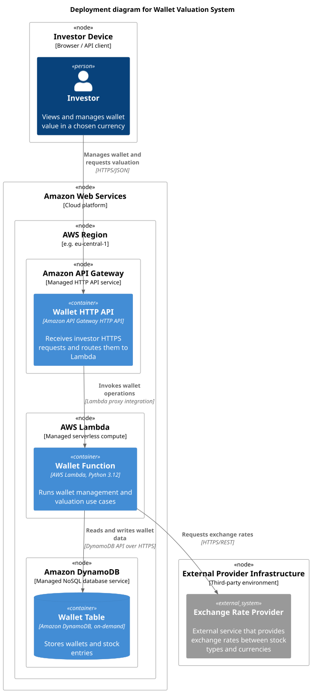

# 7. Deployment View

This chapter describes the technical infrastructure used to deploy the **Wallet Valuation System** and how software building blocks map to infrastructure elements. The deployment is intentionally simple and serverless, aligned with ADR-001 and the course-exercise scope.

## 7.1 Infrastructure Overview

### Deployment Diagram

Source: [`diagrams/deployment-view.puml`](diagrams/deployment-view.puml)

### Infrastructure Elements

| Node / Element | Technology | Responsibility | Hosted / Related Building Blocks |
|---|---|---|---|
| **Investor Device** | Browser / API client | Initiates wallet management and valuation requests on behalf of the investor. | Investor actor |
| **Amazon API Gateway** | Managed HTTP API service | Provides the public HTTPS entry point, routes requests, and invokes the Lambda function. | Wallet HTTP API |
| **AWS Lambda** | Managed serverless compute, Python 3.12 runtime | Executes stateless request handling, application orchestration, domain valuation, and infrastructure adapters. | Wallet Function |
| **Amazon DynamoDB** | Managed NoSQL database service, on-demand billing | Persists wallet data with managed availability and scaling. | Wallet Table |
| **External Provider Infrastructure** | Third-party environment | Hosts the external exchange-rate capability outside the system boundary. | Exchange Rate Provider |

## 7.2 Mapping of Building Blocks to Infrastructure

| Building Block (Chapter 5) | Deployment Target | Deployment / Runtime Notes |
|---|---|---|
| **Wallet HTTP API** | Amazon API Gateway HTTP API | Configured as the HTTP front door. Routes are defined in the AWS SAM template and integrated with the Wallet Function via Lambda proxy integration. |
| **Wallet Function** | AWS Lambda (Python 3.12) | Packaged and deployed as a serverless function by AWS SAM. Runs statelessly per request; configuration (e.g., table name, rate provider endpoint/settings) is supplied through environment variables and IAM permissions. |
| **Wallet Table** | Amazon DynamoDB on-demand table | Provisioned by AWS SAM. Access patterns are designed around wallet lookup and persistence; no server capacity management is required. |
| **Exchange Rate Provider** | External third-party service | Not deployed by this system. Accessed at runtime over HTTPS/REST through the Exchange Rate Provider Adapter. |

## 7.3 Deployment and Operations Considerations

| Concern | Approach | Rationale / Constraint |
|---|---|---|
| **Infrastructure as Code** | The API, the Lambda function, and the DynamoDB table are defined in one AWS SAM template and deployed as a single stack with `sam build` and `sam deploy` (ADR-001). | TC-4; keeps deployment reproducible and simple for the course project. |
| **Scaling** | API Gateway, Lambda, and DynamoDB on-demand scale automatically with request volume. | Low, variable traffic and low operational effort (Quality Goal 3). |
| **Cost model** | Serverless, pay-per-use/on-demand services; no always-on compute. | Scales to zero when idle (ADR-001 rationale). |
| **Configuration** | Runtime configuration (DynamoDB table name, rate provider endpoint, timeouts, secrets references) provided through SAM/Lambda configuration mechanisms. | Keeps environment-specific details out of domain logic; supports adapter replacement (TC-5). |
| **Observability** | Use AWS-native logs/metrics (e.g., CloudWatch logs and Lambda/API Gateway metrics) as the baseline. | Minimal operational setup appropriate for course scope; detailed observability strategy can evolve in Chapter 8. |
| **Availability / failure handling** | The managed AWS components provide baseline availability; the external rate provider remains an availability risk. | External dependency failures must produce explicit valuation errors (Quality Goal 4, ADR-001 consequences). |
| **Security boundaries** | Public boundary is HTTPS at API Gateway; the Lambda function has an execution role with least-privilege access to the Wallet Table only. Outbound rate-provider calls use HTTPS/REST. | Aligns with TC-6 and least-privilege serverless deployment practice. |
| **AWS region** | The AWS region is a deployment parameter, not an architectural decision. The deployment diagram uses `eu-central-1` only as an example. | Keeps the architecture portable across regions while allowing a concrete default in deployment configuration. |
| **Environments** | One environment (a single stage) is assumed for the course scope. Additional environments (for example, separate dev/staging/prod stages) are a later decision. | Matches the course-exercise scope and avoids premature operational complexity. |
